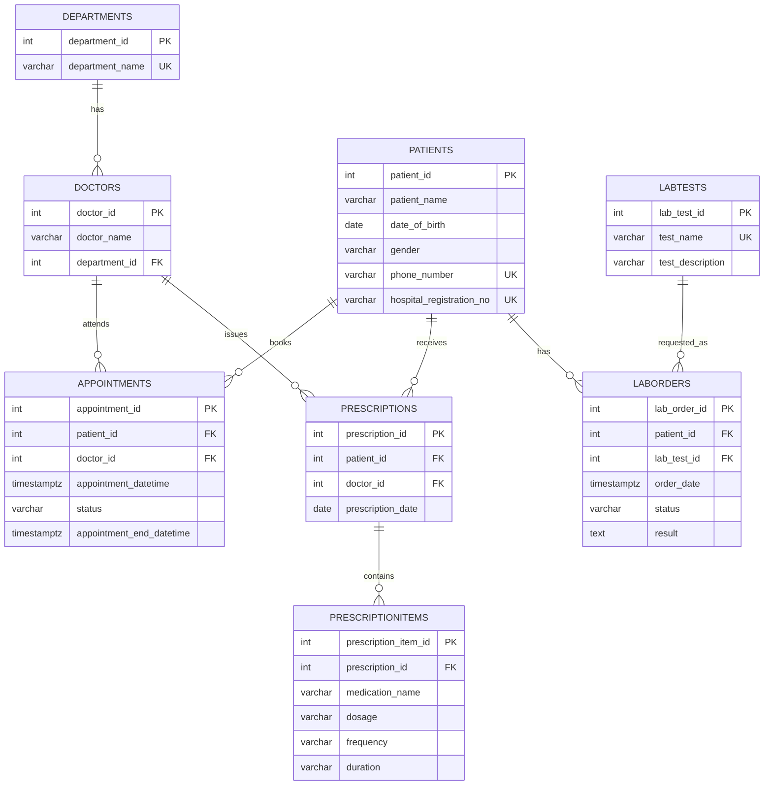

# Portfolio 1: Database Design and Modelling

## 1. CareBridge Database Design and ER Diagram

CareBridge is a small hospital-management database prototype developed to demonstrate how relational database design can support more organised patient, appointment, prescription and laboratory information management. It is a practical demonstration using sample records, not a fully deployed hospital system.

The database contains eight related tables:

- `departments`
- `doctors`
- `patients`
- `appointments`
- `prescriptions`
- `prescriptionitems`
- `labtests`
- `laborders`

### Entity-Relationship Diagram

The following ER diagram is based on the table columns and foreign-key relationships verified in the PostgreSQL database.



### Explanation of the entities and relationships

- **Departments and Doctors:** One department can have multiple doctors. Each doctor references a department through `department_id`.
- **Doctors and Appointments:** A doctor can have multiple appointments. Each appointment references the doctor assigned to it.
- **Patients and Appointments:** A patient can have multiple appointments. Each appointment references the patient attending it.
- **Patients and Prescriptions:** A patient can receive multiple prescriptions. Each prescription references its patient.
- **Doctors and Prescriptions:** A doctor can issue multiple prescriptions. Each prescription references the doctor who issued it.
- **Prescriptions and PrescriptionItems:** One prescription can contain multiple medication items. Each item references its prescription through `prescription_id`.
- **Patients and LabOrders:** A patient can have multiple laboratory orders. Each order references the patient.
- **LabTests and LabOrders:** A type of laboratory test can be used in multiple orders. Each order references a test in the `labtests` table.

The symbols in the Mermaid diagram represent relationship cardinality. `||` means exactly one, while `o{` means zero or many. For example, one department can have zero or many doctors, while each doctor is linked to one department.

### Keys and integrity constraints

- **Primary keys (PK):** Each of the eight tables has a primary key that uniquely identifies its records.
- **Foreign keys (FK):** The eight foreign-key constraints connect related records and help maintain referential integrity.
- **Unique constraints:** Department names, laboratory test names, patient phone numbers and hospital registration numbers are protected against duplicate values.
- **Appointment uniqueness:** The `unique_doctor_appointment` constraint applies to the combination of `doctor_id` and `appointment_datetime`, preventing the same doctor from having two appointments with the same start time.
- **Check constraint:** `valid_appointment_time` ensures that `appointment_end_datetime` is later than `appointment_datetime`.
- **Additional appointment protection:** The database also has overlap-prevention constraints for patient and doctor appointments.

The appointment start and end columns and the laboratory-order `order_date` column use PostgreSQL `TIMESTAMPTZ` so stored event times represent timezone-aware instants. Existing appointment and laboratory-order values were interpreted as Africa/Lagos local time during migration. The appointment overlap constraints use `tstzrange()` with the half-open range `'[)'`, allowing one appointment to begin exactly when another ends. The laboratory-order date defaults to `CURRENT_TIMESTAMP`. The prescription date remains `DATE` with a `CURRENT_DATE` default because it represents a calendar date rather than a time instant. General `created_at` and `updated_at` audit columns have not been added to the current schema.

## 1.1 Relational Normalisation

The CareBridge relational model was organised to reduce unnecessary duplication and protect data integrity. Its design can be explained using the first three normal forms:

- **First Normal Form (1NF):** Each table has a primary key, and each field stores a single value rather than a repeating list. Medication details are stored as separate rows in `prescriptionitems`, rather than placing several medicines in one field in `prescriptions`.
- **Second Normal Form (2NF):** The tables use single-column primary keys, so there are no partial dependencies on part of a composite primary key. Attributes describing a doctor, patient or laboratory test are kept in their own tables and referenced through foreign keys.
- **Third Normal Form (3NF):** Non-key attributes describe the key, the whole key and nothing but the key. For example, `department_name` is stored in `departments`, while `doctors` stores the related `department_id`; department details are not repeated for every doctor. Test descriptions are stored in `labtests`, not repeated in each laboratory order.

The separate `prescriptions` and `prescriptionitems` tables allow one prescription to contain multiple medication items without repeating prescription-level details. This structure reduces update anomalies and makes relationships enforceable through foreign keys. This is an explanation of the logical design, not a claim that a formal normalisation tool was run.

## 2. Database Tables and Constraints

**SQL Code**

```sql
SELECT
    table_name,
    constraint_name,
    constraint_type
FROM information_schema.table_constraints
WHERE table_schema = 'public'
  AND table_name IN (
      'departments',
      'doctors',
      'patients',
      'appointments',
      'prescriptions',
      'prescriptionitems',
      'labtests',
      'laborders'
  )
  AND constraint_name !~ '^[0-9]+_[0-9]+_[0-9]+_not_null$'
ORDER BY table_name, constraint_type;
```

**Evidence**


**Further Explanation:** This query displays the CareBridge database tables and their constraints, which help maintain data accuracy and integrity.

## 3. Prescription Details Using JOIN

**SQL Code**

```sql
SELECT
    p.prescription_id,
    pt.patient_name,
    d.doctor_name,
    pi.medication_name,
    pi.dosage,
    pi.frequency,
    pi.duration
FROM prescriptions p
JOIN patients pt
    ON p.patient_id = pt.patient_id
JOIN doctors d
    ON p.doctor_id = d.doctor_id
JOIN prescriptionitems pi
    ON p.prescription_id = pi.prescription_id;
```

**Evidence**


**Further Explanation:** The JOIN combines related records to display each patient's medication, dosage, frequency, duration and prescribing doctor.

## 4. Laboratory Orders Using JOIN

**SQL Code**

```sql
SELECT
    lo.lab_order_id,
    pt.patient_name,
    lt.test_name,
    lo.order_date,
    lo.status,
    lo.result
FROM laborders AS lo
INNER JOIN patients AS pt
    ON lo.patient_id = pt.patient_id
INNER JOIN labtests AS lt
    ON lo.lab_test_id = lt.lab_test_id;
```

**Evidence**


**Further Explanation:** This query connects patient records with laboratory tests to display the requested test, its status and available results.

## 5. Appointment-Overlap Constraints

**SQL Code**

```sql
SELECT
    conname AS constraint_name,
    conrelid::regclass AS table_name,
    pg_get_constraintdef(oid) AS constraint_definition
FROM pg_constraint
WHERE conname IN (
    'no_overlapping_patient_appointments',
    'no_overlapping_doctor_appointments'
);
```

**Evidence**


**Further Explanation:** These constraints prevent patients and doctors from being assigned overlapping appointments, helping to avoid scheduling conflicts.

## 6. Trigger Protection

**SQL Code**

```sql
SELECT
    trigger_name,
    event_object_table,
    action_timing,
    event_manipulation
FROM information_schema.triggers
WHERE trigger_schema = 'public'
  AND trigger_name IN (
      'prescription_must_have_item',
      'prescription_item_integrity',
      'prevent_completed_lab_order_delete'
  )
ORDER BY event_object_table, trigger_name;
```

**Evidence**


**Further Explanation:** These triggers enforce hospital rules by ensuring prescriptions contain medication items and protecting completed laboratory orders from deletion.

## 7. SQL Implementation Files

The SQL implementation is organised into two separate files so that database creation and integrity testing can be reviewed independently.

- **[CareBridge Database Setup Script](CareBridge_Portfolio1_Database_Design.sql):** Creates the eight tables in dependency order, defines primary and foreign keys, unique and check constraints, appointment-overlap protection and integrity triggers, then inserts valid sample records. It includes verification queries.
- **[CareBridge Integrity Tests](CareBridge_Portfolio1_Integrity_Tests.sql):** Contains inspection queries and separate, commented test statements for duplicate registration numbers, invalid foreign keys, invalid appointment times, overlapping appointments, prescriptions without medication items and deletion of completed laboratory orders.

**Important:** The setup script is intended for a new, empty database. It should not be run against an existing CareBridge database because the tables and constraints already exist. The negative test statements are commented out and should be executed individually in a separate test database or test copy.

## 8. Test Database Integrity Evidence

The setup script and integrity rules were also tested in a separate PostgreSQL database named `carebridge_test`. This kept the negative tests separate from the main CareBridge database. The test database contains two laboratory-order sample records: Ada Nwosu's completed Malaria Test and Ibrahim Bello's pending Full Blood Count (with a `NULL` result). The live main `carebridge` database contains one laboratory order, and the pre-migration backup also contains one. These are separate database copies with different sample-data states; the pending test record was not present in the main database or its backup.

The test evidence demonstrates:

- Successful creation of all eight tables and retrieval of related prescription and laboratory records using JOIN queries.
- Rejection of duplicate hospital registration numbers, invalid patient foreign keys and invalid appointment time ranges.
- Prevention of overlapping appointments for both patients and doctors.
- Trigger protection against committing prescriptions without medication items and deleting completed laboratory orders.
- Final record counts confirming that the original sample data remained unchanged after testing.

The [Test Database Evidence README](evidence/Test%20Database%20Evidence/README.md) describes all 11 screenshots and links to each image.

## Tools and Technologies

- PostgreSQL 16
- pgAdmin 4
- Mermaid ER diagram
