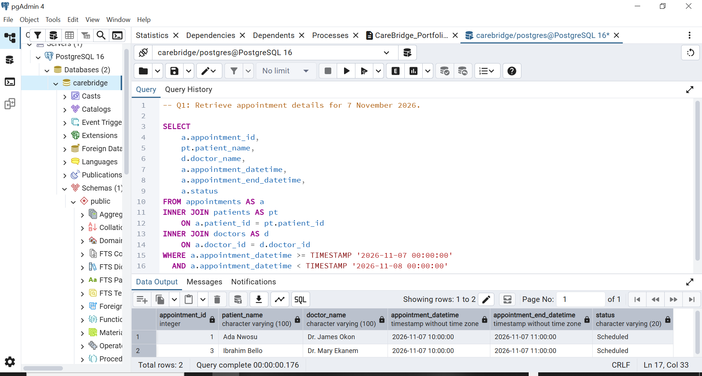
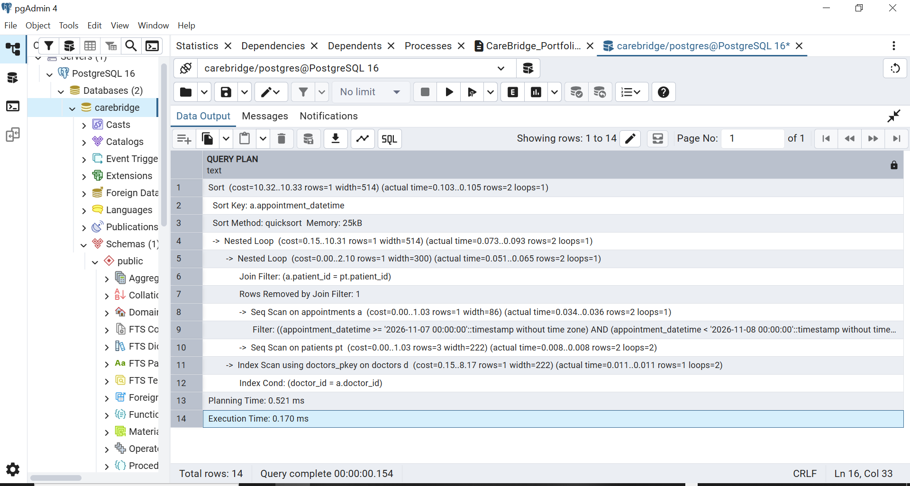
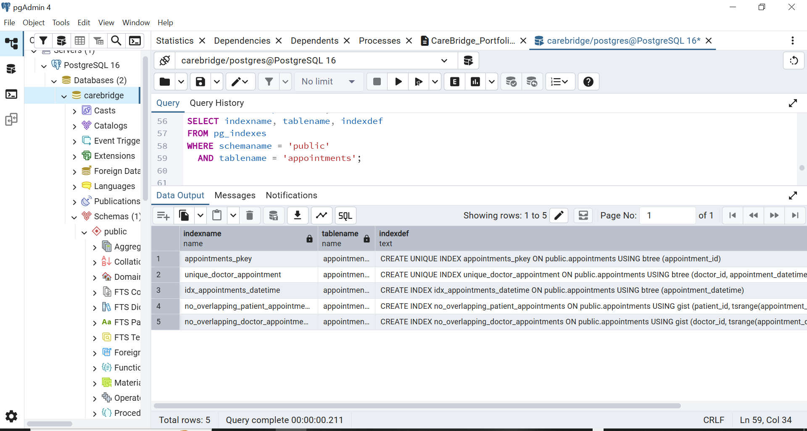
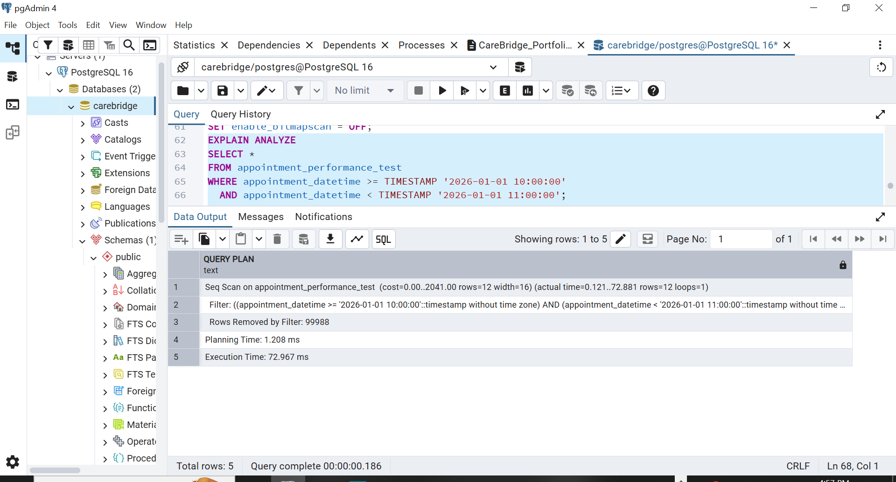
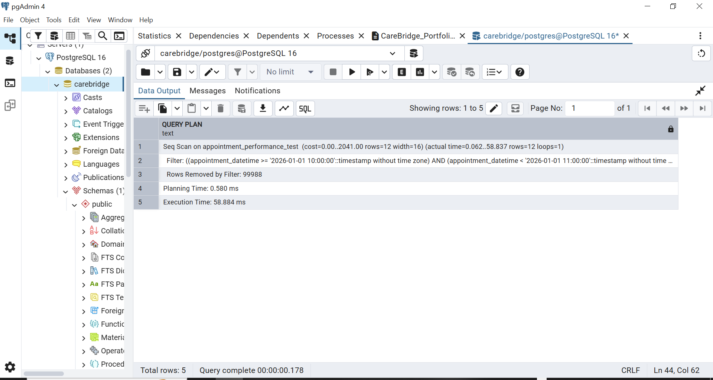
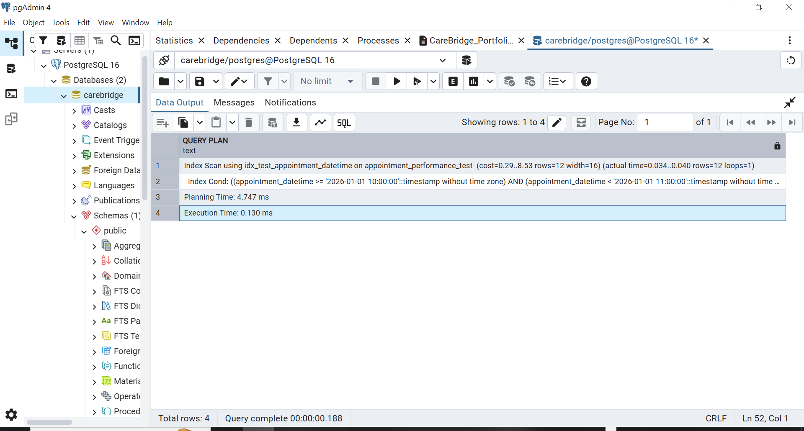

# Portfolio 2: Query Processing and Optimisation

## 1. Introduction

This portfolio demonstrates query processing and optimisation using the CareBridge hospital database. The practical activities cover appointment retrieval, query execution plans, index creation and verification, and performance testing using a larger simulated dataset.

The exercises were carried out using PostgreSQL 16.5 and pgAdmin 4.

## 2. Appointment Retrieval Using JOIN Operations

The following query retrieves appointment information for 7 November 2026 by combining the appointments, patients and doctors tables.

```sql
SELECT
    a.appointment_id,
    pt.patient_name,
    d.doctor_name,
    a.appointment_datetime,
    a.appointment_end_datetime,
    a.status
FROM appointments AS a
INNER JOIN patients AS pt
    ON a.patient_id = pt.patient_id
INNER JOIN doctors AS d
    ON a.doctor_id = d.doctor_id
WHERE a.appointment_datetime >= TIMESTAMP '2026-11-07 00:00:00'
  AND a.appointment_datetime < TIMESTAMP '2026-11-08 00:00:00'
ORDER BY a.appointment_datetime;
```

**Further Explanation**

The INNER JOIN operations connect appointment records to their corresponding patient and doctor details. The date conditions restrict the results to appointments scheduled for 7 November 2026, while ORDER BY arranges them chronologically. The query returned two appointment records.

## 3. Examining the Initial Execution Plan

```sql
EXPLAIN ANALYZE
SELECT *
FROM appointments;
```

**Further Explanation**

EXPLAIN ANALYZE executes the query and displays the execution plan alongside actual execution statistics. The initial plan showed PostgreSQL using sequential scans on the small appointments and patients tables. This demonstrated that PostgreSQL can select a sequential scan when reading a small table is estimated to be more efficient than accessing an index.

## 4. Creating and Verifying an Index

An index was created on the appointment date and time column.

```sql
CREATE INDEX idx_appointments_datetime
ON appointments (appointment_datetime);
```

The index was verified using:

```sql
SELECT indexname, tablename, indexdef
FROM pg_indexes
WHERE schemaname = 'public'
  AND tablename = 'appointments';
```

**Further Explanation**

The index provides PostgreSQL with an additional access method for locating appointments using their date and time. The verification query confirms that the index exists in the database.

However, PostgreSQL continued to use a sequential scan on the small appointments table. This demonstrated that creating an index does not guarantee its use; the query planner selects an execution strategy based on estimated cost.

## 5. Performance Testing with Simulated Records

To examine indexing on a larger dataset without modifying the original CareBridge appointments table, a separate performance-testing table was created.

```sql
CREATE TABLE appointment_performance_test (
    test_id BIGINT GENERATED ALWAYS AS IDENTITY PRIMARY KEY,
    appointment_datetime TIMESTAMP NOT NULL
);
```

A total of 100,000 simulated records were inserted.

```sql
INSERT INTO appointment_performance_test (appointment_datetime)
SELECT
    TIMESTAMP '2026-01-01 08:00:00'
    + (n * INTERVAL '5 minutes')
FROM generate_series(1, 100000) AS n;
```

The number of inserted records was verified using:

```sql
SELECT COUNT(*)
FROM appointment_performance_test;
```

**Further Explanation**

The separate table provided a larger dataset for controlled performance testing. Using simulated records allowed us to examine query execution on a larger table without changing the original hospital appointment records.

### 5.1 Performance Before Indexing

```sql
EXPLAIN ANALYZE
SELECT *
FROM appointment_performance_test
WHERE appointment_datetime >= TIMESTAMP '2026-01-01 10:00:00'
  AND appointment_datetime < TIMESTAMP '2026-01-01 11:00:00';
```

**Further Explanation**

Before indexing, PostgreSQL used a sequential scan to search the 100,000 records. The query returned 12 matching records and removed 99,988 records through filtering. The recorded execution time was 34.923 ms.

This demonstrated the work involved in searching a large table without an index on the filtered column.

### 5.2 Creating an Index on the Performance-Testing Table

```sql
CREATE INDEX idx_test_appointment_datetime
ON appointment_performance_test (appointment_datetime);
```

The same performance query was executed again:

```sql
EXPLAIN ANALYZE
SELECT *
FROM appointment_performance_test
WHERE appointment_datetime >= TIMESTAMP '2026-01-01 10:00:00'
  AND appointment_datetime < TIMESTAMP '2026-01-01 11:00:00';
```

**Further Explanation**

After creating the index, PostgreSQL selected an index scan to locate the matching appointment records. The query returned the same 12 records, with a recorded execution time of 0.130 ms.

The reduction in execution time demonstrated the potential performance benefit of indexing when searching a larger dataset. Actual execution times may vary between runs due to caching and other system conditions.

## 6. Demonstrating a Sequential Scan

To reproduce a sequential scan after the index had been created, PostgreSQL's index and bitmap scan options were temporarily disabled.

```sql
SET enable_indexscan = OFF;
SET enable_bitmapscan = OFF;
```

The performance query was then executed again using EXPLAIN ANALYZE.

After the demonstration, the normal planner settings were restored.

```sql
SET enable_indexscan = ON;
SET enable_bitmapscan = ON;
```

**Further Explanation**

This exercise demonstrated that PostgreSQL could perform a sequential scan even when an index existed. The reproduced execution plan showed 99,988 records removed by the filter.

The scan was reproduced by temporarily changing planner settings. It was not the original pre-index measurement. This helped demonstrate how execution plans can be influenced by the available scan methods.

## 7. Findings and Conclusion

The practical exercises demonstrated how PostgreSQL processes queries and selects execution strategies based on estimated costs and available indexes.

The original CareBridge appointments table was small, so PostgreSQL continued to use sequential scans even after an index was created. A separate performance-testing table containing 100,000 simulated records was therefore used to compare query execution before and after indexing.

The performance test showed a change from a sequential scan to an index scan, with the recorded execution time decreasing from 34.923 ms to 0.130 ms.

Overall, the exercise demonstrated the importance of examining execution plans, creating appropriate indexes and evaluating query performance using actual database results.

## 8. Tools and Technologies

- PostgreSQL 16.5
- pgAdmin 4
- SQL
- EXPLAIN ANALYZE
- PostgreSQL indexing and query-planning features
- GitHub for portfolio documentation and evidence management

## 9. Practical Evidence Summary

The screenshots below provide evidence of the query processing and optimisation activities carried out in the CareBridge PostgreSQL database. They show the appointment retrieval query, initial and indexed execution plans, index verification, sequential scan demonstration, and performance comparison using 100,000 simulated appointment records.

Together, the evidence demonstrates how PostgreSQL evaluates query execution strategies and how indexing can improve retrieval performance when working with larger datasets.

### Evidence Files













