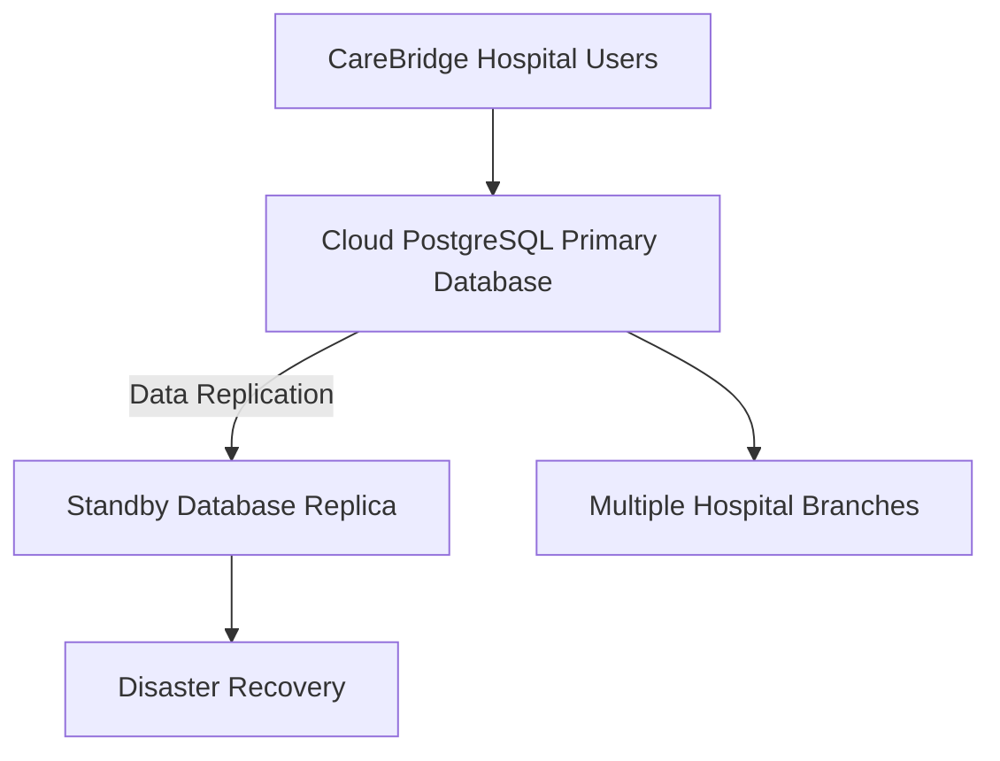

# Portfolio 5: Distributed and Cloud Database Exercise

## Case Study: CareBridge Hospital Management System

### 1. Introduction

CareBridge Hospital Management System is a relational database solution developed using PostgreSQL to manage hospital operations, including patient records, appointments, prescriptions, doctors and laboratory orders.

As the hospital expands its services across multiple branches, a distributed and cloud-based database architecture can improve data availability, scalability, disaster recovery and access to information.

This exercise proposes a cloud-based PostgreSQL architecture for CareBridge, focusing on database replication, availability, consistency, scalability and security.

### 2. Proposed Distributed Database Architecture

The proposed architecture consists of the following components:

**Figure 1: Proposed distributed and cloud database architecture for CareBridge.**

The primary database handles the hospital's main transactions, while replication maintains a separate copy of the database on a standby server. The standby replica supports recovery if the primary database becomes unavailable. The architecture also provides a foundation for supporting multiple hospital branches.
  
### 3. Database Replication and Availability

Database replication involves maintaining copies of data across multiple database servers. In the proposed CareBridge architecture, the primary PostgreSQL database sends changes to a standby replica.

PostgreSQL supports two major replication approaches:

**Synchronous Replication:** The primary database waits for confirmation that changes have been received by the standby server before confirming a transaction. This provides stronger data consistency but may increase transaction latency.

**Asynchronous Replication:** The primary database confirms transactions without waiting for the standby server to acknowledge every change. This can improve transaction performance, although the replica may temporarily lag behind the primary database.

For CareBridge, synchronous replication may be considered for critical patient and prescription records where minimising data loss is important. Asynchronous replication may be suitable where performance and network latency are greater concerns.

The standby replica can support disaster recovery if the primary database fails. However, automatic failover requires additional configuration and monitoring.

This approach improves resilience and supports database availability, helping CareBridge maintain access to important hospital information.

### 4. Data Consistency Across Hospital Branches

Data consistency ensures that users and database replicas work with accurate and reliable information.

For CareBridge, consistency is important because patient records, prescriptions, appointments and laboratory results must remain accurate across the hospital's database environment.

The proposed architecture uses PostgreSQL transactions and replication to maintain data integrity.

The following measures will support consistency:

- **ACID transactions:** Ensure that database operations are atomic, consistent, isolated and durable.
- **Primary database writes:** Direct critical updates to the primary database to avoid conflicting updates across replicas.
- **Replication monitoring:** Monitor replication lag to identify delays between the primary database and standby replica.
- **Access control:** Restrict database modifications to authorised personnel.
- **Data validation:** Apply constraints such as primary keys, foreign keys, unique constraints and check constraints.

For critical patient information, the primary database remains the authoritative source. Read operations against a standby replica should account for possible replication delays, particularly when asynchronous replication is used.

These measures help maintain reliable patient information and reduce inconsistencies across CareBridge operations.
