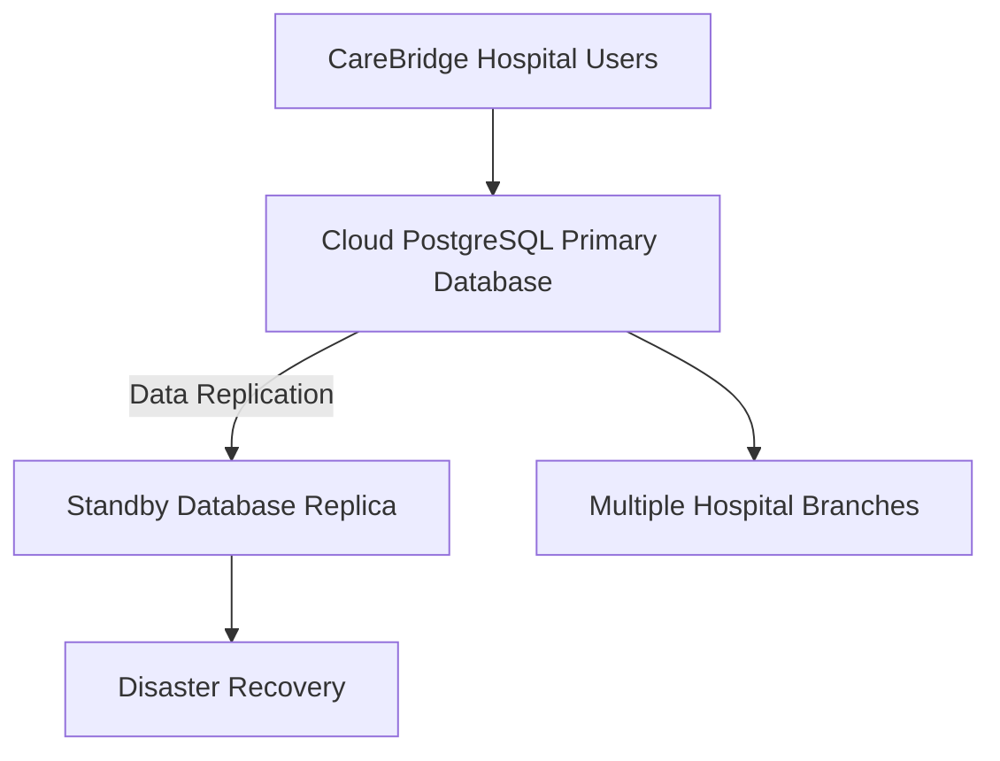

# Portfolio 5: Distributed and Cloud Database Exercise

## Case Study: CareBridge Hospital Management System

### 1. Introduction

CareBridge Hospital Management System is a relational database solution developed using PostgreSQL to manage hospital operations, including patient records, appointments, prescriptions, doctors and laboratory orders.

As the hospital expands its services across multiple branches, a distributed and cloud-based database architecture can improve data availability, scalability, disaster recovery and access to information.

This exercise examines how distributed and cloud database concepts can be applied to CareBridge, focusing on database replication, availability, consistency, scalability and security.

### 2. Proposed Distributed Database Architecture

The proposed architecture consists of the following components:

**Figure 1: Proposed distributed and cloud database architecture for CareBridge.**

The primary database handles the hospital's main transactions, while replication maintains a separate copy of the database on a standby server. The standby replica supports recovery if the primary database becomes unavailable. The architecture also provides a foundation for supporting multiple hospital branches.

### 3. Database Replication and Availability

Database replication involves maintaining copies of data across multiple database servers. In the proposed CareBridge architecture, the primary PostgreSQL database sends changes to a standby replica.

PostgreSQL supports two major replication approaches:

**Synchronous Replication:** The primary database waits for confirmation that changes have been received by the standby server before confirming a transaction. This provides stronger data consistency but may increase transaction latency.

**Asynchronous Replication:** The primary database confirms transactions without waiting for the standby server to acknowledge every change. This can improve transaction performance, although the replica may temporarily lag behind the primary database.

For CareBridge, synchronous replication may be considered for critical patient and prescription records where minimising data loss is important. Asynchronous replication may be suitable where performance and network latency are greater concerns.

The standby replica can support disaster recovery if the primary database fails. However, automatic failover requires additional configuration and monitoring.

This approach improves resilience and supports database availability, helping CareBridge maintain access to important hospital information.

#### 3.1 Local PostgreSQL Streaming Replication Demonstration

Two PostgreSQL 16 instances were configured locally, with the primary on port 5432 and the standby on port 5433. The `pg_basebackup` utility was used to create the standby database cluster.

Streaming replication was verified using PostgreSQL monitoring functions. A test record inserted into the primary CareBridge database was successfully retrieved from the standby, confirming that replication was working.

**Scope:** This practical demonstration was conducted on one computer. It was not a deployment across separate physical servers or a live cloud environment.

### 4. Data Consistency Across Hospital Branches

Data consistency ensures that users and database replicas work with accurate and reliable information.

For CareBridge, consistency is important because patient records, prescriptions, appointments and laboratory results must remain accurate across the hospital's database environment.

The proposed architecture uses PostgreSQL transactions and replication to maintain data integrity.

The following measures will support consistency:

- **ACID transactions:** Ensure that database operations are atomic, consistent, isolated and durable.
- **Primary database writes:** Direct critical updates to the primary database to avoid conflicting updates across replicas.
- **Replication monitoring:** Monitor replication lag to identify delays between the primary database and standby replica.
- **Access control:** Restrict database modifications to authorised personnel.
- **Data validation:** Apply constraints such as primary keys, foreign keys, unique constraints and check constraints.

For critical patient information, the primary database remains the authoritative source. Read operations against a standby replica should account for possible replication delays, particularly when asynchronous replication is used.

These measures help maintain reliable patient information and reduce inconsistencies across CareBridge operations.

### 5. Cloud Database Deployment and Scalability

CareBridge can deploy its PostgreSQL database using Amazon Relational Database Service (Amazon RDS) for PostgreSQL. This portfolio includes a practical RDS deployment, described in Section 5.1, alongside the proposed architecture.

Amazon RDS is a managed database service that provides database hosting, automated backups, monitoring and options for high availability.

The proposed cloud deployment offers the following benefits:

- **Scalability:** Database resources can be increased as patient records and hospital transactions grow.
- **Managed backups:** Automated backups support data recovery.
- **High availability:** Multi-AZ deployment can maintain a standby database in another Availability Zone and support failover.
- **Accessibility:** Authorised users can securely access the database from different hospital branches.
- **Maintenance:** Managed database services reduce the administrative burden of routine database operations.

CareBridge can initially use a single primary database with a standby replica. As the hospital expands, additional read replicas can help distribute read workloads.

For future horizontal scaling, patient records and operational data could be distributed across hospital branches using a carefully designed sharding strategy. This would require additional application logic and coordination to maintain data consistency.

Cloud deployment would also require secure network configuration, encryption, role-based access control and regular backup testing.

#### 5.1 Practical Amazon RDS Deployment

A live cloud database instance was provisioned using **Amazon RDS for PostgreSQL** in the AWS Europe (Stockholm) region. The instance uses PostgreSQL 16 and was configured as a single-AZ deployment.

The practical configuration included:

| Configuration | Deployment detail |
|---|---|
| Managed service | Amazon RDS for PostgreSQL |
| Engine version | PostgreSQL 16.12 |
| DB instance identifier | `carebridge-postgres` |
| Database | `carebridge` |
| Instance class | `db.t4g.micro` |
| Availability | Single-AZ |
| Storage | 20 GiB General Purpose SSD |
| Connection port | 5432 |
| Client | pgAdmin 4 |

The RDS endpoint was registered in pgAdmin 4 and a successful remote connection was established. The database was accessible from the local workstation after the security group was configured to allow PostgreSQL TCP traffic on port 5432 only from the authorised client IPv4 address. This restricted inbound rule reduced exposure compared with allowing connections from all IP addresses.

The database's encryption at rest was enabled using the AWS-managed RDS encryption key. A manual RDS snapshot was also created and its status was confirmed as **Available**, providing a recovery point for the deployed instance.

##### Cloud database verification

The `carebridge` database hosted on RDS was inspected through the pgAdmin Query Tool. All eight application tables were queried individually, followed by a consolidated record-count query.

| Table | Verified records |
|---|---:|
| Departments | 5 |
| Doctors | 3 |
| Patients | 3 |
| Appointments | 2 |
| Prescriptions | 2 |
| Prescription items | 2 |
| Lab tests | 3 |
| Lab orders | 1 |
| **Total** | **21** |

The verification confirmed that the cloud database contained the CareBridge schema and the records shown above. The individual table queries and consolidated count query provide evidence of successful database access and data retrieval from the RDS instance.

**Important migration limitation:** The AWS `carebridge` database was already populated when it was inspected. The local migration backup was created separately and was not restored into this RDS database during this exercise. Therefore, this practical work demonstrates cloud provisioning, remote connectivity, database inspection, record verification and snapshot creation; it does not claim that a local-to-cloud backup restoration was completed.

##### Deployment considerations and limitations

The deployed instance used a single Availability Zone. It demonstrates a live managed cloud database, but it does not by itself provide Multi-AZ high availability or automatic failover. A separate Multi-AZ configuration, monitoring and recovery testing would be required to demonstrate those capabilities.

The instance was publicly accessible to support the pgAdmin connection, but its inbound database rule was restricted to one authorised IPv4 address. For a production hospital system, private networking, application-level access, least-privilege database roles, secure credential management, encryption in transit, audit logging and tested backup restoration should be implemented. The public access rule should be removed or replaced with private connectivity when direct external administration is no longer required.

The selected instance and storage also have ongoing AWS costs. A production deployment should be sized using workload measurements and monitored for storage, backup, data-transfer and compute charges.

### 6. Security and Risk Management

CareBridge handles sensitive patient information, making database security essential in both local and cloud environments.

The proposed architecture will adopt the following security measures:

- **Authentication:** Require verified user credentials before granting database access.
- **Role-Based Access Control (RBAC):** Assign permissions according to staff responsibilities. For example, doctors, laboratory personnel and receptionists should have different access privileges.
- **Encryption:** Protect patient information during transmission and while stored in the cloud.
- **Multi-Factor Authentication (MFA):** Add another layer of protection for administrative and privileged accounts.
- **Backup and Recovery:** Maintain regular backups and periodically test database restoration procedures.
- **Monitoring and Auditing:** Record database access and administrative activities to identify suspicious behaviour.
- **Network Security:** Restrict database access to trusted networks and authorised application servers.

Potential risks include network outages, replication delays, unauthorised access, cloud service disruptions and accidental data loss.

These risks can be reduced through secure configuration, continuous monitoring, tested recovery procedures and appropriate access management.

CareBridge must also ensure that its handling of patient information complies with applicable Nigerian data protection requirements, including the Nigeria Data Protection Act (NDPA) 2023.

### 7. Recommendations

Based on the proposed architecture, the following recommendations are made for CareBridge:

1. Adopt a managed PostgreSQL cloud service to support database scalability and reduce infrastructure maintenance.
2. Configure database replication to maintain a standby copy of critical hospital records.
3. Use appropriate replication settings based on the hospital's consistency and performance requirements.
4. Implement automated backups and regularly test disaster recovery procedures.
5. Apply role-based access control, encryption and multi-factor authentication to protect patient information.
6. Consider branch-based sharding only when the volume of data and number of hospital branches justify the additional complexity.
7. Monitor database performance, replication lag and availability continuously.

### 8. Conclusion

The proposed distributed and cloud database architecture provides CareBridge Hospital Management System with a foundation for improved scalability, availability, data protection and disaster recovery.

PostgreSQL replication can support database resilience, while cloud services such as Amazon RDS provide managed infrastructure and high-availability options.

This exercise combines a local PostgreSQL streaming replication demonstration with a practical Amazon RDS cloud deployment. The RDS instance was accessed remotely through pgAdmin, and all eight CareBridge tables were inspected with 21 records verified in total. A manual RDS snapshot was also created. The documented migration limitation is that the local backup was not restored into the already-populated AWS database.

The design also highlights the importance of balancing consistency, availability, performance and security when planning a distributed database environment.

### 9. References

1. Miva Open University. (2026). *MIT 8103: Advanced Database Systems, Study Session 2, Lecture 2: Distributed Databases*. Course lecture materials.

2. Miva Open University. (2026). *MIT 8103: Advanced Database Systems, Study Session 2, Lecture 3: Cloud Databases*. Course lecture materials.

3. PostgreSQL Global Development Group. (n.d.). *High Availability, Load Balancing, and Replication*. https://www.postgresql.org/docs/current/high-availability.html

4. Amazon Web Services. (n.d.). *Amazon RDS Documentation*. https://docs.aws.amazon.com/AmazonRDS/latest/UserGuide/Welcome.html

